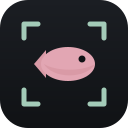
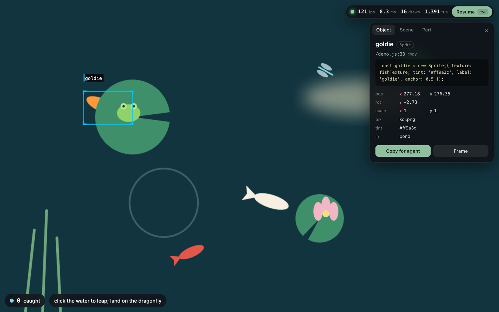

<p align="center">
  
</p>

<h1 align="center">PixiTools</h1>

<p align="center">Click a sprite in your Pixi game. Get the line of code that made it.</p>

<p align="center">
  <a href="https://github.com/joydle/PixiTools/actions/workflows/ci.yml"></a>
  <a href="#license"></a>
  <a href="https://joydle.github.io/PixiTools/"></a>
</p>

<p align="center">
  <a href="https://joydle.github.io/PixiTools/"></a>
</p>

An inspector and a profiler that run in the page, next to your game. For
people, a bar in the corner; for scripts and coding agents, the same answers
as JSON. [Play with it](https://joydle.github.io/PixiTools/).

## Install

```sh
npm install --save-dev github:joydle/PixiTools
```

## Use

```js
import * as PIXI from 'pixi.js';
import { attach } from '@joydle/pixitools';

attach({ PIXI, app });
```

| | |
|---|---|
| **Pick** or <kbd>`</kbd> | pause the game and click anything in it; <kbd>Esc</kbd> to resume |
| **Object** | the selection: the line that made it, transform, texture, tint, filters and mask |
| **Scene** | the stage and the HUD as one tree |
| **Perf** | frame time, draw calls, a 0–100 score and what to fix |

### Source lines

Pixi has to say where each object is constructed. In dev, the Vite plugin
swaps `pixi.js` for a 1.1 KB wrapper that records the calling line. A
production build is untouched.

```js
// vite.config.js
import pixitools from '@joydle/pixitools/vite';
export default { plugins: [pixitools()] };

// main.js: the wrapper finds the application itself
if (import.meta.env.DEV) (await import('@joydle/pixitools')).attach();
```

TypeScript and bundles resolve through their source maps. Without a bundler,
an import map does the same: see [`site/demo.html`](site/demo.html). A working
Vite project is in [`examples/vite`](examples/vite).

## For scripts and agents

Read-only: asking never pauses, selects or draws.

```js
const { inspector, profiler } = window.__pixitools;

await inspector.agent.at(640, 360);     // what is at this pixel, topmost first
await inspector.agent.named('goldie');  // by label
inspector.agent.tree();                 // the stage and the HUD
await inspector.agent.errors();         // runtime errors with their source lines
profiler.getReport();                   // the frame profile as Markdown
```

```json
{
  "kind": "object",
  "name": "goldie",
  "metadata": {
    "typeName": "Sprite",
    "position": { "x": 782.1, "y": 313.78 },
    "texture": "koi.png",
    "tint": "#ff9a3c",
    "originalSource": "/demo.js",
    "originalLine": 33,
    "originalSourceLine": "const goldie = new Sprite({ texture: fishTexture, tint: '#ff9a3c', label: 'goldie', anchor: 0.5 });"
  }
}
```

## Inside an editor

In an iframe the tools speak `postMessage`; the built-in bar is one such host
and can be left out. Every message is in [docs/PROTOCOL.md](docs/PROTOCOL.md).

```js
attach({ panel: false, host: { origin: 'https://editor.example' } });

// the editor
frame.contentWindow.postMessage({ type: 'INSPECTOR_PAUSE' }, gameOrigin);
addEventListener('message', (e) => {
  if (e.data?.source === 'pixitools' && e.data.type === 'OBJECT_SELECTED') show(e.data.metadata);
});
```

Name the host's `origin` on any page other sites can frame.

## What it reports

- **Objects**: sprites, graphics, text, meshes and containers by their bounds;
  HUD elements over the canvas by geometry. `object.inspectorLayer = n`
  overrides which wins when they overlap.
- **Source**: file, line and the text of the line, through source maps.
- **Looks**: the texture by name, the tint, the filters and mask attached,
  visible and renderable here and in every parent. A field Pixi has no concept
  of is left out, never a made-up zero.
- **Errors**: uncaught errors, rejected promises and `console.error`.
- **Frames**: frame time and percentiles, CPU and GPU time, draw calls and
  triangles counted at the WebGL calls, state changes, long frames. Texture
  memory is an estimate; Pixi exposes no shader or geometry counts.
- **Advice**: the bottleneck, and warnings with the number that tripped them.
- **Pictures**: the view with the HUD composited in, or a dragged region.

## Notes

- Types ship with the package. `attach` checks its arguments by shape, so it
  needs no Pixi types.
- Pixi v8, WebGL renderer.
- With a minified Pixi a filter reads as `Filter`: class names are gone.
- A dev tool: it wraps the WebGL draw calls to count them, and the wrapper
  turns on `preserveDrawingBuffer` for screenshots. Keep it out of what you
  ship; the Vite plugin does.
- Your own names: every global, id, attribute and message source is in
  [`src/brand.ts`](src/brand.ts). Build from `@joydle/pixitools/src/*` (the TypeScript source ships in the package) with
  that file replaced to ship the tools under another name.
- For three.js: [ThreeTools](https://github.com/joydle/ThreeTools). The two
  share their core; `npm run check` fails if a shared file names either tool.

## Develop

```sh
npm install
npm run check     # typecheck, tests, build
npm run serve     # the site and demo on http://127.0.0.1:4173
```

## License

MIT. Made by [Joydle](https://github.com/joydle).
